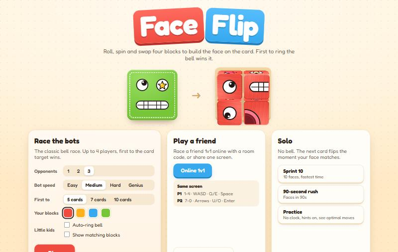
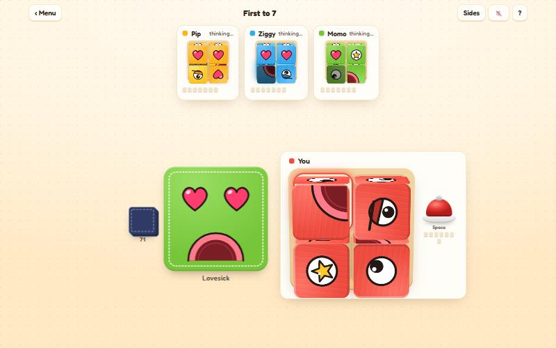
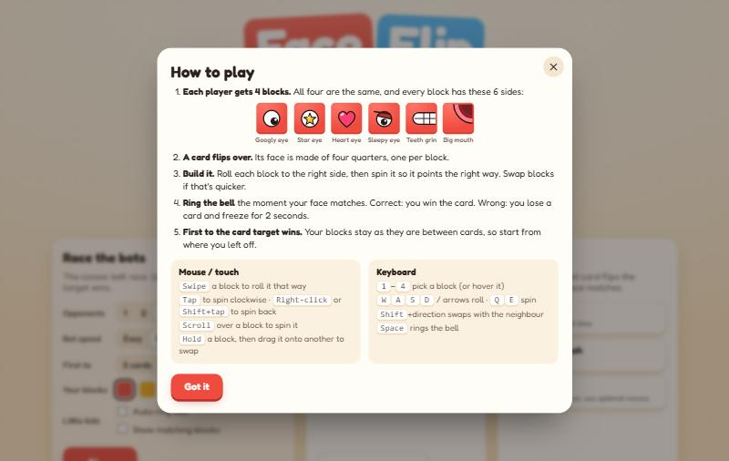
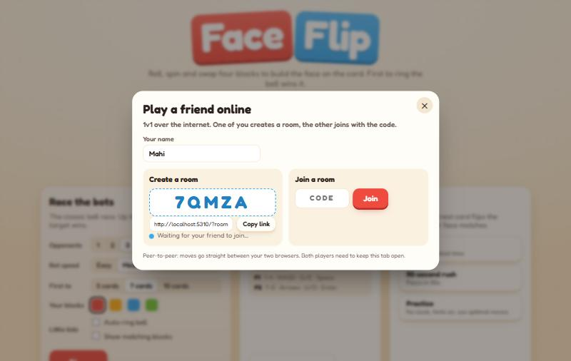

<div align="center">

# FaceFlip

**Roll, spin and swap four blocks to build the emoji on the card. First to ring the bell wins it.**

A browser version of the face changing blocks party game. Play against bots, race a friend online 1v1, or share one screen.

### [▶ Play now: maheepatel.github.io/FaceFlip](https://maheepatel.github.io/FaceFlip/)

No install, no sign up. Works on desktop, tablet and phone.



</div>

---

## Contents

- [How to play](#how-to-play)
- [Controls](#controls)
- [Game modes](#game-modes)
- [Play a friend online](#play-a-friend-online)
- [Tips to get faster](#tips-to-get-faster)
- [Run it locally](#run-it-locally)
- [How it works](#how-it-works)

---

## How to play



### What you have

Every player gets **4 wooden blocks** in their colour. All four blocks are exactly the same, and every block has these **6 sides**. Each side is one quarter of a face:

| Side | What it shows | Where it usually goes |
|---|---|---|
| Googly eye | A big eye with a pupil. Turning it changes where the eye looks | Top half |
| Star eye | A star in the eye | Top half |
| Heart eye | A heart | Top half |
| Sleepy eye | An eye with a heavy lid. Upside down it looks smug | Top half |
| Teeth grin | Half of a toothy grin. Turned around, it is the other half | Bottom half |
| Big mouth | A quarter of a wide open mouth. One way up it laughs, the other way it shouts | Bottom half |

Your 4 blocks sit in a 2 by 2 tray. Together they make one face.

### A round

1. **A card flips over.** It shows a face made of four quarters, one for each block.
2. **Build it.** For each block:
   - **Roll** it until the right side faces you.
   - **Spin** it so the picture points the right way. A side turned the wrong way does not count.
   - **Swap** blocks around if that is quicker.
3. **Ring the bell** the moment your face matches the card.
   - **Correct:** you win the card.
   - **Wrong:** you lose one card you already won and freeze for 2 seconds.
4. The next card flips. **Your blocks stay as they are**, so you start from where you left off.

### Winning

The first player to collect the card target (**5, 7 or 10 cards**, you choose) wins the match.

### How a match is checked

The game never compares pictures. Every block's position is stored as "which side faces you and how far it is turned", and each card stores the same thing for its four quarters. When you ring the bell, the game checks those four values against the card. If they match, the faces look identical, because both are drawn from the same values.

---

## Controls



### Mouse and touch

| Action | What it does |
|---|---|
| **Swipe** a block up, down, left or right | Rolls the block that way |
| **Tap / click** a block | Spins it clockwise |
| **Right click** or **Shift + tap** | Spins it the other way |
| **Scroll** over a block | Spins it |
| **Press and hold** a block, then drag it onto another | Swaps the two blocks |
| Tap the **red bell** | Rings the bell |

### Keyboard

| Key | What it does |
|---|---|
| `1` `2` `3` `4` (or hover with the mouse) | Picks a block: top left, top right, bottom left, bottom right |
| `W` `A` `S` `D` or arrow keys | Rolls the picked block |
| `Q` / `E` | Spins it left / right |
| `Shift` + direction | Swaps it with the block next to it |
| `Tab` | Picks the next block |
| `Space` | Rings the bell |

### Two players on one keyboard

| | Player 1 | Player 2 |
|---|---|---|
| Pick a block | `1` `2` `3` `4` | `7` `8` `9` `0` |
| Roll | `W` `A` `S` `D` | Arrow keys or `I` `J` `K` `L` |
| Spin | `Q` / `E` | `U` / `O` |
| Bell | `Space` | `Enter` |

On a tablet, both players can just touch their own blocks at the same time.

---

## Game modes

| Mode | Players | How it works |
|---|---|---|
| **Race the bots** | You vs 1 to 3 bots | The classic bell race. Bots play like people: they read the card, pick up one block at a time, look for the right side and sometimes turn it the wrong way. Pick Easy, Medium, Hard or Genius. |
| **Online 1v1** | You vs a friend anywhere | Create a room, send the code or link, race. See below. |
| **Same screen** | 2 players, 1 device | Head to head on one keyboard or one tablet, each with their own bell. |
| **Sprint 10** | Solo | Build 10 faces as fast as you can. No bell: the next card flips the moment you match. Your best time is saved. |
| **90 second rush** | Solo | How many faces can you build in 90 seconds? |
| **Practice** | Solo | No clock. Blocks that are already right get a green tick, the side strip stays open, and after each face you see how close you were to the fewest possible moves. |

**For little kids** there are two options in Race the bots:
- **Auto ring bell** rings for you as soon as your face matches.
- **Show matching blocks** puts a green tick on every block that is already correct.

Tap **Sides** during any game to see all 6 sides of a block.

---

## Play a friend online



1. Open the game and choose **Play a friend → Online 1v1**.
2. Type your name and click **Create room**. You get a 5 letter code such as `7QMZA`.
3. Click **Copy link** and send it to your friend on WhatsApp or anywhere else. They can also open the game, click **Online 1v1** and type the code into **Join a room**.
4. The match starts on both screens as soon as they join. You see your friend's blocks move live at the top.
5. After the match, either player can press **Play again** for a rematch.

**Good to know**
- Both players need to keep the tab open. If one leaves, the other sees "Your friend left".
- Moves travel straight between your two browsers. There is no game server and nothing is stored.
- The player who creates the room deals the cards and judges every bell ring, so both screens always agree on who scored.
- Most home Wi-Fi works fine. A few strict networks, like some mobile data carriers or office Wi-Fi, block direct browser to browser connections. If joining times out, switch one of you to another network.

---

## Tips to get faster

- **Read the card one quarter at a time.** Find the side first, then worry about the spin.
- **Any target is at most 3 moves away.** If you have made 4 or more moves on one block, you went the wrong way.
- **Right side, wrong way? Just tap.** If the side is already showing, spin it in place instead of rolling.
- **Swap instead of rolling.** If the block in the wrong slot already shows what another slot needs, hold and drag to swap them.
- **Mouths come in pairs.** The two bottom blocks usually show the same side, turned to face each other.
- **Do not ring early.** A wrong ring costs you a card and 2 seconds.

---

## Run it locally

You need [Node.js](https://nodejs.org) 20 or newer.

```bash
git clone https://github.com/maheepatel/FaceFlip.git
cd FaceFlip
npm install
npm run dev      # opens on http://localhost:5310
```

| Command | What it does |
|---|---|
| `npm run dev` | Starts the dev server |
| `npm test` | Checks the block maths and every card |
| `npm run build` | Builds the site into `dist/` |

Every push to `main` builds the game and publishes it to GitHub Pages through `.github/workflows/deploy.yml`.

---

## How it works

Built with TypeScript and Vite. No game engine and no image files: the blocks are CSS 3D and all art is drawn in SVG.

| File | Job |
|---|---|
| `src/cube.ts` | A block can sit 24 different ways. Each is stored as a rotation, and each one shows a unique side and spin, so matching is exact. A search finds the shortest way between any two positions (never more than 3 moves). |
| `src/art.ts` | Draws the 6 sides. The mouth pieces are designed so turning one gives you the matching other half, which is how 4 identical blocks build symmetric faces. |
| `src/cards.ts` | 8 eye choices × 8 × 3 mouths makes 192 possible faces. Each game deals a 72 card deck from them, like the boxed game. |
| `src/bots.ts` | The bots. They plan the fewest moves (including swaps), then play them at human speed with occasional slips. |
| `src/board.ts` | The 3D blocks and all mouse, touch and keyboard input. Each move animates as a real quarter turn. |
| `src/net.ts` | Online rooms over WebRTC using the free PeerJS service. |
| `src/main.ts` | Menus, game modes, rounds, the bell rule and scoring. |

---

<div align="center">

Inspired by the wooden face changing blocks game. All art, names and code here are original.

</div>
